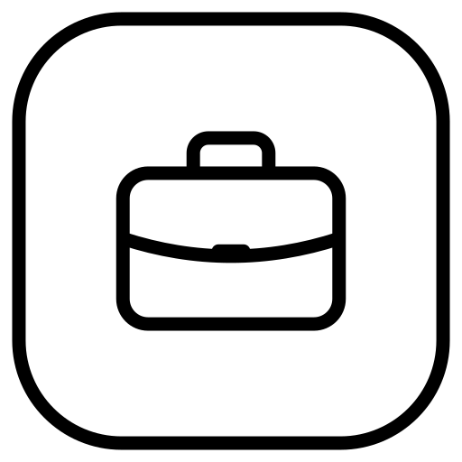

# Work

Mail, calendar, notes and to-do lists for the Mudita Kompakt, designed for E Ink. Turn off the modules you don't need; their data stays on the phone.

## What it can do

**Mail**
- iCloud, Gmail, Zoho and other IMAP/SMTP accounts
- Several accounts, with a shared view of all inboxes
- Folders and mail search
- Write, reply and forward
- Send from extra addresses set up with your provider
- Outbox: mail written offline is sent when the connection is back
- Pick recipients from your phone's contacts

**Calendar**
- Day and month views
- Sync with your account's calendars
- Add, edit and delete events, including repeating ones
- Add view-only calendars by .ics link
- A local calendar on the phone, with no sync

**Notes and to-do**
- Notes with a title and free text
- To-do lists with tasks to tick off, including repeating lists
- Search across notes and lists

**Languages:** English, Croatian, Spanish

## Good to know
- Most providers require an app-specific password instead of your normal one
- Attachments are not downloaded to the phone
- Outlook, Hotmail and Proton Mail are not supported for mail; their calendars can be added by link

## Permissions
- Internet: to reach your mail and calendar providers
- Contacts: read only, when you pick a recipient
- Camera: only to scan a QR code, while the scanner is open; no picture is saved

## Install
Download the latest APK from [Releases](../../releases/latest) and install it on your Kompakt with Mudita Center.
